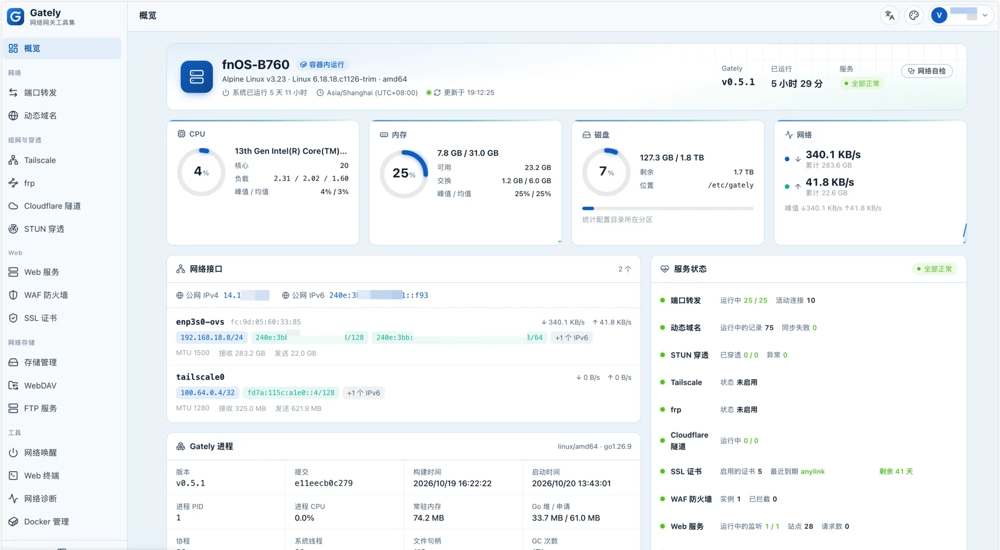
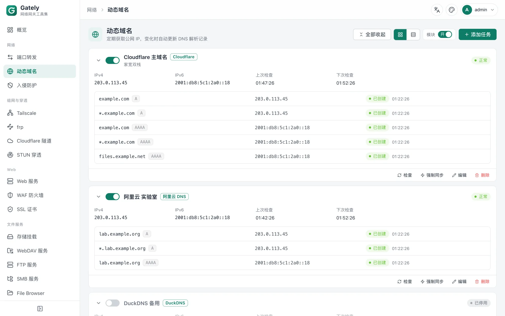
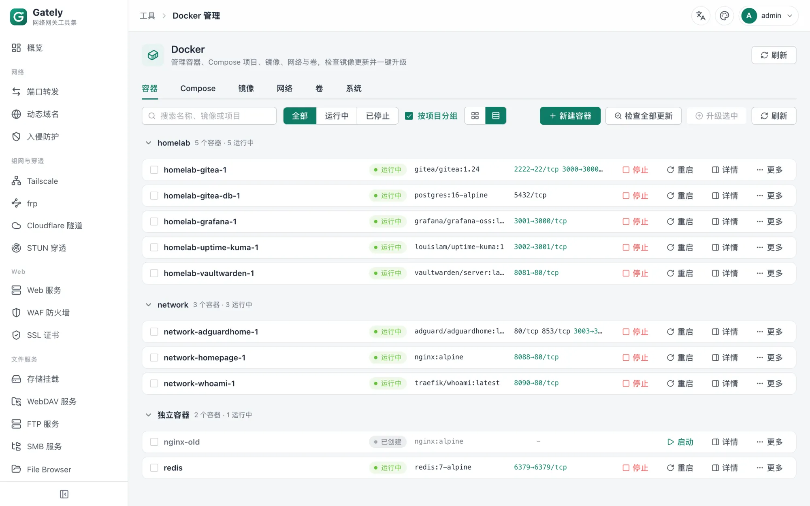

# Gately

[English](README.md) | [简体中文](README.zh-CN.md) | [繁體中文](README.zh-TW.md) | [日本語](README.ja.md) | [한국어](README.ko.md) | **Español** | [Français](README.fr.md) | [Deutsch](README.de.md) | [Русский](README.ru.md) | [Português (Brasil)](README.pt-BR.md)

Conjunto de herramientas de puerta de enlace de red, de código abierto y auditable, para redes domésticas, NAS, hosts en la nube y todo tipo de servidores. DDNS, túneles STUN, reenvío de puertos, proxy inverso, certificados, WAF y otras funciones habituales se integran en un único archivo de unos 32 MB, y es posible importar configuraciones existentes de Lucky.







## Por qué Gately

Gately es totalmente abierto para que usuarios y comunidad puedan revisar directamente el código fuente y la configuración. Un software que se ejecuta en el borde de la red y maneja claves DNS y claves privadas de certificados debe permitir que los usuarios vean lo que hace. Los compromisos de Gately:

- El código fuente es abierto bajo Apache-2.0 y acepta la revisión de la comunidad
- Por defecto no se conecta a ningún servidor del proyecto ni reporta información del dispositivo; el inicio de sesión de terceros usa tu propia aplicación OAuth, sin intermediarios
- Todas las direcciones externas (consulta de IP pública, servidores STUN, etc.) son visibles, editables y se pueden desactivar
- La configuración es JSON en texto plano, que puedes versionar en git para auditoría y reversión

## Funciones

| Módulo | Capacidades |
| --- | --- |
| DNS dinámico | Alibaba Cloud, Cloudflare, Tencent Cloud, DNSPod, Huawei Cloud, GoDaddy, Porkbun, dynv6, DuckDNS, Amazon Route 53, OVHcloud, Gandi, NS1, Bunny DNS, Namecheap, DynDNS2 (No-IP, Dynu, …), callback personalizado; obtención de IP por URL/interfaz de red/comando; IPv4/IPv6; Webhook |
| Túnel STUN | TCP/UDP, keep-alive, UPnP/NAT-PMP, reenvío integrado, activación de Webhook y scripts al cambiar la dirección |
| Reenvío de puertos | TCP/UDP, IPv4/IPv6, rangos de puertos, conmutación por error con varios destinos, límite de conexiones, estadísticas de tráfico, protocolo PROXY v1/v2 |
| Certificados SSL | Emisión y renovación automáticas con ACME mediante DNS-01 (comodín) o HTTP-01 (sin proveedor DNS), EAB, carga manual, lectura desde archivo, mapeo a un directorio y ejecución de scripts |
| Tailscale | Gestiona tailscaled (red en espacio de usuario, apta para contenedores) o se conecta a un demonio existente del sistema; clave de autenticación/enlace de inicio de sesión, Headscale, rutas de subred, nodo de salida, lista de nodos y proxy SOCKS5, puerto fijo, argumentos adicionales y variables de entorno de tailscaled |
| frp | Cliente frpc (proxies tcp/udp/http/https/stcp/xtcp, los cambios se aplican al añadir o eliminar) y servidor frps (lista blanca de puertos, subdominios, panel de control); importación con un clic de configuraciones ini antiguas y toml nuevas |
| Túnel Cloudflare | Túnel con token de cloudflared y túnel temporal de trycloudflare, varios túneles, reinicio automático, visualización de la dirección pública |
| Servicio web | Proxy inverso/redirección/archivos estáticos/texto fijo por dominio; HTTPS y HTTP/3 (QUIC); WebSocket; envío y recepción del protocolo PROXY; autenticación básica, autenticación web, inicio de sesión con GitHub/Google/QQ/OIDC; listas blancas y negras de IP, reglas por ruta, enlaces temporales para compartir, bloqueo automático tras fallos de autenticación, filtrado de países con GeoIP; pesos de backend/respaldo/balanceo de carga, comprobaciones de salud activas y pasivas, compresión, limitación de tasa, caché de respuestas, reescritura de rutas; estadísticas de acceso por minuto y métricas de Prometheus |
| Cortafuegos WAF | Coraza + OWASP CRS v4, activación de reglas por archivo, SecLang personalizado, bloqueo/solo detección |
| Gestión de Docker | Creación y edición de contenedores, registros y terminal, Compose, comprobación de actualizaciones de imágenes y actualización con un clic (reversión automática si falla), redes y volúmenes |
| Terminal web | SSH (confianza en la clave del host en el primer uso), Telnet, shell local (desactivado por defecto); proxy, sesiones persistentes, gestión de archivos SFTP, 2FA y confirmación de protocolo, comandos rápidos, paneles divididos |
| Diagnóstico de red | Ping, traceroute, sondeo de puertos, consultas DNS, prueba de velocidad, escaneo de la red local |
| Centro de notificaciones | Webhook, Telegram, Bark, ntfy, Gotify, Pushover, Discord, Slack, ServerChan, PushPlus, WeCom, DingTalk, Feishu, correo electrónico; niveles, comodines y reglas de silencio y deduplicación; plantillas de reglas integradas (fallos críticos, vencimiento de certificados, cambios de dirección, inicios de sesión, cambios de configuración) |
| Copia de seguridad de la configuración | Copias cifradas (scrypt + AES-GCM), política de retención, copias programadas a un directorio local o a un punto de montaje de almacenamiento |
| Línea de comandos y MCP | `gately ctl` invoca una instancia en ejecución; `gately mcp` ofrece un servicio MCP por stdio (solo lectura por defecto) |
| Wake-on-LAN | Difusión de paquetes mágicos, detección de estado en línea |
| WebDAV | Multiusuario, directorio independiente por usuario, solo lectura |
| FTP | Multiusuario, directorio independiente por usuario, solo lectura, compatible con FTPS y rango de puertos pasivos |
| Gestión de almacenamiento | Directorios locales y montajes WebDAV remotos, gestión de archivos en línea |
| Tareas programadas | Expresiones cron, comandos o solicitudes HTTP, historial de ejecuciones |
| Seguridad y ajustes | Inicio de sesión con passkey (WebAuthn), verificación en dos pasos (TOTP), cuentas de solo lectura, limitación de intentos de inicio de sesión, entrada de seguridad, acceso solo desde la red interna, HTTPS para la interfaz de administración, varios tokens de API (permisos de lectura/escritura por módulo), DNS personalizado (compatible con DoH), zona horaria, copia de seguridad y restauración de la configuración, dirección real del cliente desde proxies inversos locales de confianza |
| Auditoría e historial | Registro de auditoría de inicios de sesión, cambios de configuración y accesos a contenido sensible (nunca registra cuerpos de petición ni secretos); cada archivo de configuración sobrescrito conserva sus versiones anteriores con comparación de diferencias y reversión con un clic; directorio de configuración declarativa (`-apply`) para GitOps |
| Monitorización y autodiagnóstico | Endpoint global de Prometheus `/api/metrics` (certificados, DDNS, STUN, reenvío de puertos, servicios web) con un panel de Grafana listo para usar; autodiagnóstico de red con un clic (IP pública, CGNAT, reloj, puertos 80/443, resolución DDNS, vencimiento de certificados) |
| Migración | Importa `.lkcf` de Lucky o el zip de configuración completa: reenvío de puertos, DDNS, STUN, certificados, proxy inverso, WAF, Wake-on-LAN, terminal web, WebDAV, ajustes básicos |

## Inicio rápido

### Docker

La imagen es compatible con amd64, arm64 y arm/v7:

```bash
docker run -d --name gately --network host \
  -v ./gately-data:/etc/gately \
  -v /var/run/docker.sock:/var/run/docker.sock \
  ghcr.io/wangwanjie/gately:latest
docker logs gately 2>&1 | grep -i "initial password"
```

Abre `http://<IP del dispositivo>:16680`, inicia sesión con `admin` y la contraseña inicial que aparece en el registro, y después cambia la contraseña y activa la verificación en dos pasos en «Ajustes». Encontrarás un ejemplo completo de Compose en [deploy/docker-compose.yml](deploy/docker-compose.yml).

El reenvío de puertos, STUN y el servicio web necesitan escuchar puertos del host, por lo que se recomienda `--network host`. Si no necesitas la gestión de Docker, puedes quitar el montaje de `docker.sock`.

### Binario

Descarga el paquete de tu plataforma desde [Releases](https://github.com/wangwanjie/gately/releases) (Linux amd64/arm64/arm/mips/mipsle/riscv64, macOS, Windows, FreeBSD), descomprímelo y ejecuta:

```bash
./gately -c /etc/gately
```

Parámetros: `-c` directorio de configuración (también se puede usar la variable de entorno `GATELY_CONFIG_DIR`), `-listen` sobrescribe la dirección de escucha de la interfaz de administración, `-apply` aplica en cada arranque los archivos `<nombre>.json` de un directorio al directorio de configuración (`GATELY_APPLY_DIR`, útil para GitOps y Kubernetes; los archivos de cuentas y tokens no se pueden sobrescribir), `-version` muestra la versión. En instalaciones desatendidas, define `GATELY_INITIAL_PASSWORD` para elegir la contraseña inicial del administrador en lugar de leer una aleatoria del registro.

Plantillas de servicio: [systemd](deploy/systemd/gately.service) y [OpenWrt procd](deploy/openwrt/gately.init). Para verificar los archivos e imágenes descargados (firmas cosign, procedencia de compilación, SBOM), consulta [Verificar los artefactos publicados](docs/en/VERIFY.md).

### Monitorización

Crea un token de API con solo el permiso `metrics:read` y apunta Prometheus a `/api/metrics`. Las métricas, los ejemplos de alertas y el panel de Grafana se describen en [Monitorización](docs/en/MONITORING.md).

### Uso de la API

Crea un token en la página «Tokens de API» del panel de administración (puedes crear varios, conceder solo lectura o lectura y escritura por módulo, definir una fecha de caducidad; el texto del token se muestra una sola vez tras crearlo) y tus scripts podrán llamar en lote a la API de administración:

```bash
curl -H "Authorization: Bearer gtl_xxxx" http://localhost:16680/api/ddns/tasks
```

Las API de cuenta, verificación en dos pasos y gestión de tokens, así como las de copia de seguridad, restauración, reinicio y ajustes del sistema, solo admiten sesiones iniciadas. Todas las API, los permisos necesarios y las estructuras de datos están en la página «Documentación de la API» del panel de administración; también puedes exportarlos con `make api-docs` a [docs/api](docs/api/es) (`openapi.json` y `API.md`), que el sitio web https://gately.cn referencia directamente al publicarse.

Al actualizar desde una versión anterior, el token de API global original se convierte automáticamente en un «token heredado» (el valor no cambia y conserva todos los permisos de módulo). Se recomienda restringir sus permisos o sustituirlo por un token nuevo en la página de tokens de API.

### Tailscale, frp, cloudflared

Estos tres módulos gestionan programas externos oficiales (reinicio automático, registros agregados en la interfaz). Gately no los incluye, de modo que siempre puedes usar la última versión del proyecto original. Los programas se buscan en este orden: la ruta indicada en la configuración del módulo, `PATH` y el subdirectorio `bin/` del directorio de configuración. En despliegues con Docker, basta con colocar el binario en el directorio de configuración montado, por ejemplo `./gately-data/bin/frpc`; Tailscale requiere proporcionar tanto `tailscale` como `tailscaled`. Los tokens y claves de los archivos de configuración se guardan con permisos 0600, y el token de cloudflared se pasa mediante una variable de entorno, por lo que no aparece en la lista de procesos.

### Migrar desde Lucky

Consulta la [guía de migración](https://gately.cn/es/docs/guide/migration). Pasos resumidos: en «Ajustes → Importar desde Lucky», selecciona el archivo `lucky_*.lkcf` del directorio de configuración de Lucky, revisa la vista previa e importa; las reglas importadas quedan desactivadas por defecto, así que desactívalas en Lucky y actívalas en Gately módulo por módulo.

## Desarrollo

Requisitos: Go 1.26+, Node.js 24+, pnpm.

```bash
make web      # compila el frontend (salida en web/dist, incrustado con go:embed)
make build    # compila bin/gately
make test     # go test -race ./...
make lint     # gofmt, go vet, comprobación de tipos del frontend
```

Para desarrollar el frontend, ejecuta `cd web && pnpm dev`; `/api` se redirige al servidor local `127.0.0.1:16680`.

Algunas pruebas se omiten por defecto y requieren condiciones adicionales:

| Prueba | Cómo activarla |
| --- | --- |
| ACME de extremo a extremo (Pebble) | Instala pebble y pebble-challtestsrv y define `GATELY_PEBBLE_BIN` y `GATELY_PEBBLE_SRC` (se ejecuta automáticamente en CI) |
| Servidores STUN públicos reales | `GATELY_NET_TEST=1` |
| Verificar la importación con una configuración real de Lucky | `GATELY_LUCKY_SAMPLE`, etc.; consulta `TestImportRealSample` en cada módulo |

La estructura de directorios y la selección tecnológica están en [docs/ROADMAP.md](docs/ROADMAP.md).

El código del sitio web ([gately.cn](https://gately.cn)) está en `website/` y se basa en VitePress: `cd website && pnpm install && pnpm dev`; `pnpm deploy:site` compila y sincroniza con el servidor.

## Normas de contribución

- La compatibilidad con Lucky se basa en comportamientos, interfaces y formatos de configuración observables públicamente. No envíes código copiado de los binarios o de los artefactos del frontend de Lucky.
- Los módulos nuevos requieren: estructura de configuración y validación, inicio y parada en tiempo de ejecución, interfaz REST y pruebas unitarias; los módulos que se puedan migrar desde Lucky implementan `luckyimport.Importer`, y los que quieran mostrar su estado en la página de resumen implementan `module.Summarizer`.
- Los comentarios del código se escriben en chino; las sentencias de control deben usar siempre llaves.

## Comunidad

Las preguntas, comentarios y consejos de uso son bienvenidos en el grupo de Telegram: [t.me/gately_chat](https://t.me/gately_chat). Los errores se reportan en [GitHub Issues](https://github.com/wangwanjie/gately/issues).

## Evolución de estrellas

[](https://star-history.com/#wangwanjie/gately&Date)

## Licencia

[Apache License 2.0](LICENSE)
